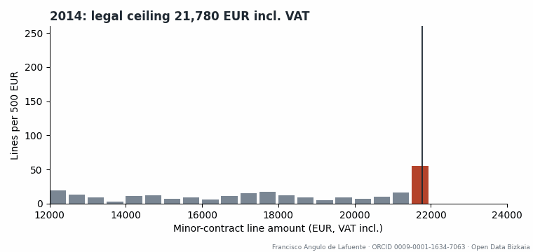
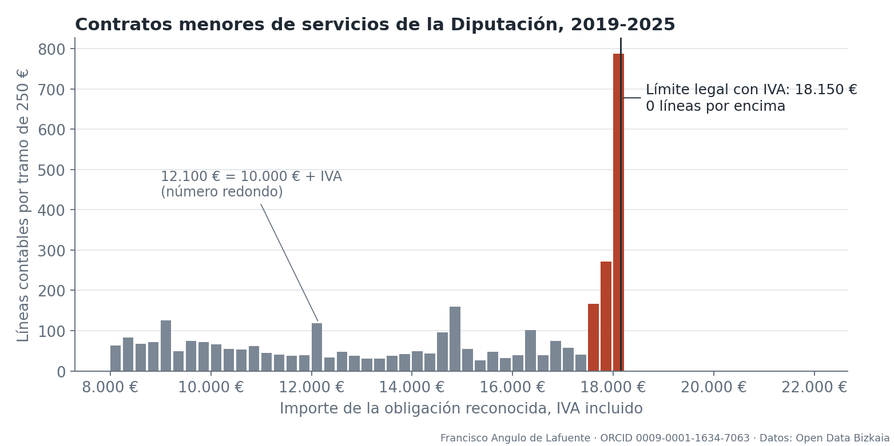
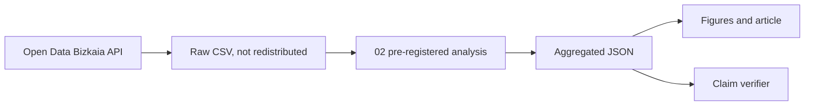

# Down to the last cent

**Accounting-line patterns near the minor-procurement thresholds at the Diputación Foral de Bizkaia.**

Data-journalism investigation prepared for the Reto del Periodismo de Datos 2026 (category c). The article is in Spanish: [pieza/REPORTAJE.pdf](pieza/REPORTAJE.pdf). Technical report: [pieza/INFORME_TECNICO.pdf](pieza/INFORME_TECNICO.pdf).



*Animated histogram built from the real data, one frame per year. Lines of services and supplies.*

<!-- impact-note:start -->
<sub><strong>Efficiency and practical value.</strong> The reproducible CPU analysis replaces repeated manual aggregation of procurement records with traceable calculations, sensitivity checks and source-linked figures. It supports more transparent examination of how public resources are allocated without training a model or requiring a GPU. The observed accounting patterns support investigation rather than proving wrongdoing. See the <a href="#number-verification">verification method</a> and <a href="#limits-of-the-evidence">evidence limits</a>.</sub>
<!-- impact-note:end -->

## Main result

From 2019 to 2025, 1,105 service lines fall in the 500 EUR below 18,150 EUR (15,000 EUR plus 21% VAT), and none in the 500 EUR above it. The density ratio just under that amount is 8.09. A new supplier-cluster bootstrap gives a 95% sensitivity interval of [7.09, 9.26]; the original line-resampling interval was [7.31, 8.97]. The observed counts describe the archived records exactly. Resampling intervals depend on a hypothetical sampling model.

When the 2017 law lowered the ceiling, the pile moved: the ratio under 21,780 EUR was 6.33 before the reform, and no line remains there after 2019.



| Pre-registered test | Result | Decision |
|---|---|---|
| E1 Ratio under 18,150 EUR, services 2019-2025 above 2 | 8.09; cluster interval [7.09, 9.26] | Original numeric criterion met; observational evidence |
| E2 Before/after threshold comparison | 2.40 to 8.09; old upper band/reference empty after reform | Descriptive pattern; the later B(21,780) is undefined (0/0), so the planned interval comparison is unavailable |
| E3 Same test at IFAS | Current effect 6.22 (3.45–12.00); pre-reform sample too small | Inconclusive |
| E4 Placebo values | 16,000: 0.63; 20,000: invalid design; 12,100: 2.09 | Partial |
| E5 Works contracts | 2.00 to 7.66 under 48,400 EUR | Complementary descriptive pattern under the same reform; smaller sample |

The full plan is in [experiments/PREREG.md](experiments/PREREG.md) and all outcomes, including negatives, are in [experiments/LOG.md](experiments/LOG.md).

## Limits of the evidence

The data show a pattern and do not establish wrongdoing. The unit is an accounting line, not always a whole contract. The dataset has no detailed purchase description, department or identified effective VAT rate. The 21% VAT assumption does not exclude exempt amounts or other tax rates from the observed band. There is no untreated control group for the reform. No contractor is named.

## Number verification

The original literal checker is preserved. The revised `verificacion/verificar_revisado.py` performs 91 numeric-source checks and binds seven revised claims to their phrases. It rejects seven targeted swaps of already-valid numbers that retain both numbers elsewhere in the text; the global-literal control rejects none of those seven. These are targeted regression checks, not a general detection benchmark. Historical sentence placement still requires independent review.

The exploratory supplier sensitivity uses 4,281 name clusters, 10,000 replicates and seed 20261109. The paired change in B(18,150) is 5.70, interval [4.43, 7.02]. Leaving out a supplier gives B between 8.01 and 8.21; leaving out a year gives 7.64 to 8.44. [Protocol and results](auditoria/) preserve the original scope and limitations. A fresh-context independent review checked synthetic calculations, aggregate ratios, statement associations and both PDFs; its VAT finding was reproduced and corrected.

## Reproduce



*Conceptual diagram of the pipeline.*

```bash
python notebook/00_catalogo.py
python notebook/01_descarga.py contratos-menores contratos-menores-del-ifas contratos-no-menores contratos-no-menores-del-ifas liquidacion-del-presupuesto plan-anual-de-contratacion-pac
python notebook/02_analisis.py
python notebook/03_exploratorio.py
python notebook/04_figuras.py
python auditoria/audit_robustness.py
python verificacion/verificar_revisado.py
python notebook/crear_cuaderno.py
```

Raw files carry contractor names, so they are not in this repository. `datos/manifest.jsonl` lists each URL and SHA-256. The portal may update files, and later downloads can differ.

The complete isolated notebook was executed on 9 November 2026: five code cells, no error outputs, identical historical aggregates and figure bytes, and exactly reproduced supplier-sensitivity results. Library versions are recorded in [auditoria/ENVIRONMENT.json](auditoria/ENVIRONMENT.json). The PDF builder uses Windows Edge and visible author/ORCID footers.

**Entry status:** reviewed materials, not officially submitted. The final [Decree 73/2026](https://www.bizkaia.eus/lehendakaritza/Bao_bob/2026/07/27/I-865_cas.pdf) permits an open website entry and closes on 20 November at 13:00 Europe/Madrid. Personal signature, declarations and a platform receipt remain pending. AI assistance is disclosed: Claude prepared the original analysis; Codex audited and revised it. Authorship and editorial responsibility: Francisco Angulo de Lafuente.

**Energy.** CPU only, no model training, no GPU. No training energy to report.

## Related literature

Palguta, J. and Pertold, F. (2017). Manipulation of Procurement Contracts: Evidence from the Introduction of Discretionary Thresholds. *American Economic Journal: Economic Policy* 9(2), 293–315. https://doi.org/10.1257/pol.20150511

## Author context

See [docs/AUTHOR_CONTEXT.md](docs/AUTHOR_CONTEXT.md). Code: Apache-2.0. Article and figures: copyright of the author while the competition is open.

<!-- author-background:start -->
## Author background

**Francisco Angulo de Lafuente**, independent AI researcher · [ORCID](https://orcid.org/0009-0001-1634-7063) · [arXiv](https://arxiv.org/a/angulodelafuente_f_1.html) · [Google Scholar](https://scholar.google.com/citations?user=6nOpJ9IAAAAJ) · [ResearchGate](https://www.researchgate.net/profile/Francisco-Angulo-Lafuente-3) · [Figshare](https://figshare.com/authors/Francisco_Angulo_de_Lafuente/22601234) · [Wikipedia](https://es.wikipedia.org/wiki/Francisco_Angulo_de_Lafuente)

Earlier research at ECOFA focused on biotechnology for clean energy and on second-generation biofuels obtained by microbiological processing of organic waste. Two Spanish patents document that work:

- **ES 2273594 B1**, *Process for obtaining fuels from organic waste*. Filed 5 September 2005, grant published 16 February 2008. [OEPM](https://www.oepm.es/pdf/ES/0000/000/02/27/35/ES-2273594_B1.pdf) · [Google Patents](https://patents.google.com/patent/ES2273594B1/en)
- **ES 2341194 B1**, *Method for obtaining paraffin by a biological process with microorganisms from organic matter, and its refining for use as fuel*. Filed 11 September 2007, grant published 26 April 2011. Also published as EP2196519 and WO2009034217. [OEPM](https://www.oepm.es/pdf/ES/0000/000/02/34/11/ES-2341194_B1.pdf) · [Google Patents](https://patents.google.com/patent/ES2341194B1/en)

These are historical publication and grant records under the inventor name Francisco Angulo Lafuente, and both have since lapsed. They are cited as evidence of a research trajectory and make no statement about current enforceability.
<!-- author-background:end -->
