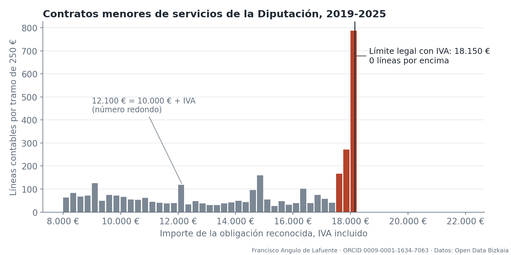
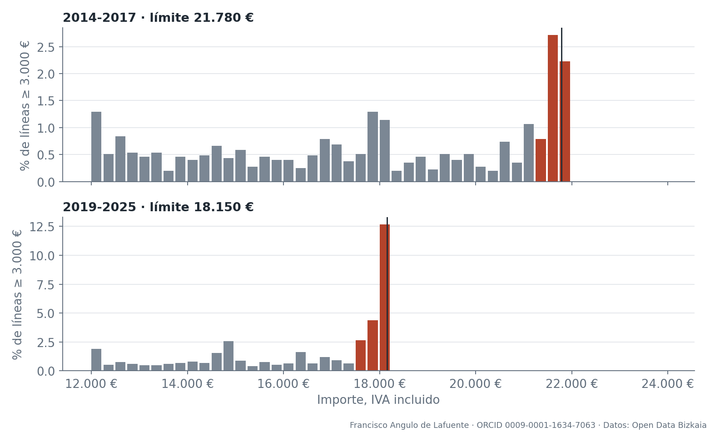
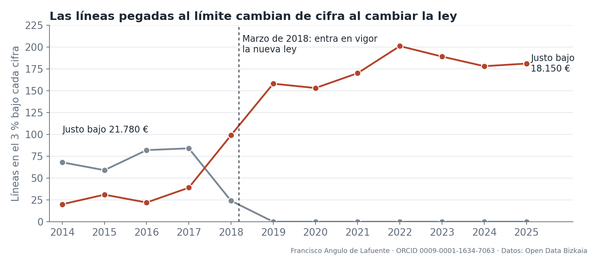
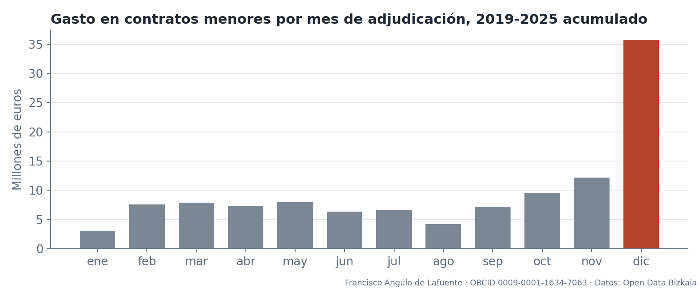

# Hasta el último céntimo

## Los importes de los contratos menores de Bizkaia se agrupan cerca de los topes de adjudicación

*Investigación basada en datos de Open Data Bizkaia · Francisco Angulo de Lafuente · ORCID 0009-0001-1634-7063*

Hay una cifra que se repite en las cuentas de la Diputación Foral de Bizkaia y que no se parece a un precio: **18.149,99 euros**. Aparece en 15 líneas contables de contratos menores entre 2019 y 2025. Con el tipo general del 21 % de IVA, es el importe que resulta al redondear 14.999,99 euros más el impuesto. La ley define el contrato menor de servicios o suministros como aquel de valor estimado [inferior a 15.000 euros](https://www.boe.es/buscar/act.php?id=BOE-A-2017-12902). La comparación exige cautela desde el principio: una obligación contable con IVA no revela por sí sola el valor estimado del contrato completo, que es la magnitud a la que se aplica el límite.

El contrato menor es la puerta rápida de la contratación pública: una administración puede encargar un trabajo directamente, sin licitación abierta. La Autoridad Vasca de la Competencia recuerda que existe para atender [«necesidades excepcionales de escasa cuantía»](https://www.cnmc.es/sites/default/files/editor_contenidos/Promocion/Municipios%20y%20competencia/202211_MyC_DECÁLOGO%20CONTRATACIÓN%20MENOR.pdf), en un decálogo (LEA/AVC n.º 581-PROM-2022) alojado en la web de la CNMC. La pregunta de este reportaje es sencilla: **¿cómo se distribuyen los importes cerca de esos topes y qué información falta para interpretarlos?**

Para contestarla se han analizado las [42.074 líneas contables](https://www.opendatabizkaia.eus/es/catalogo/contratos-menores) de contratos menores que la Diputación ha publicado desde 2014. La respuesta tiene dos caras, y las dos importan. Ninguna línea de servicios o suministros superó el límite entre 2019 y 2025. Pero una parte relevante del gasto se ha instalado justo debajo de él.

*Figura 1. Fuente: [Contratos menores](https://www.opendatabizkaia.eus/es/catalogo/contratos-menores), Open Data Bizkaia. Cada barra es un tramo de 250 euros.*

## Una pared en los 18.150 euros

La distribución de los importes es tranquila hasta que se acerca al límite. Entonces se dispara y se corta. En los 500 euros anteriores a 18.150 hay **1.105 líneas de servicios**. En los 500 euros posteriores hay **0**. En suministros ocurre lo mismo a menor escala: 101 líneas debajo y 0 encima.

Para medirlo se compara cuántas líneas hay por euro en el 3 % inmediatamente inferior al límite con cuántas hay en el tramo anterior, entre el 85 % y el 97 % del límite. Una razón de 1 indicaría la misma densidad en ambas franjas; esta referencia descriptiva no constituye un contrafactual de lo que habría ocurrido sin límite. En servicios, entre 2019 y 2025, vale **8,09**. Al remuestrear conjuntamente todas las líneas de cada proveedor, el intervalo de sensibilidad del 95 % va de **7,09 a 9,26**. Dicho de otra forma: pegado al tope hay unas ocho veces más densidad de líneas que un poco más abajo. El resultado apenas cambia al omitir un proveedor cada vez: la razón queda entre 8,01 y 8,21. Al omitir un año, entre 7,64 y 8,44.

La comparación con algunas cifras redondas ofrece otro punto de referencia, sin descartar por sí sola todas las explicaciones alternativas. Los 12.100 euros (10.000 más IVA) también atraen contratos, con una razón de 2,09 (de 1,70 a 2,55), casi cuatro veces menor. Y cuando se repite el cálculo en cifras sin significado legal (9.000, 11.000, 13.000, 14.000, 16.000 y 17.000 euros), la razón se queda entre 0,63 y 0,95. Ninguna llega a 1.

En servicios y suministros, las líneas de esa franja del 3 % suman **1.230 y 22,17 millones de euros** en siete años, unos 3,17 millones al año. Son solo el 3,68 % de las 33.395 líneas de contratos menores de 2019 a 2025, pero concentran el 19,19 % de su dinero. La inmensa mayoría son pequeñas: el 57,04 % de esas líneas no llega a 1.000 euros. Lo que pesa está arriba.

## La comparación antes y después de la reforma

Que los contratos se acumulen bajo un tope podría tener explicaciones ajenas a la ley. Pero la ley ofreció una comparación muy útil. Hasta marzo de 2018 el límite de servicios y suministros era de [18.000 euros sin IVA](https://www.boe.es/buscar/act.php?id=BOE-A-2011-17887), es decir, 21.780 euros con él. La [Ley 9/2017](https://www.boe.es/buscar/act.php?id=BOE-A-2017-12902) lo bajó a 15.000. Si los importes siguen al tope, la acumulación debería mudarse de una cifra a otra.

Eso es lo que muestran los datos, con una salvedad: no hay un grupo de control, y la misma ley introdujo otras exigencias, como el informe justificativo.

*Figura 2. Fuente: Contratos menores, Open Data Bizkaia. Cada panel tiene su propia escala vertical. Antes de 2019 el dataset solo recoge líneas de 3.000 euros o más, y por eso se compara sobre ese suelo.*

Entre 2014 y 2017 la razón bajo 21.780 euros era de 6,33 (de 5,21 a 7,73). Desde 2019 no queda allí ni una sola línea. Mientras, la razón bajo 18.150 euros pasó de 2,40 (de 1,85 a 3,05) a 8,09. La diferencia entre estas dos razones es de 5,70 puntos; su intervalo de sensibilidad, conservando juntas las líneas de cada proveedor antes y después, va de 4,43 a 7,02. Esta comparación sigue sin un grupo no expuesto a la reforma. Para ese 2,40 inicial hay una posible explicación, no comprobada sin el tipo de IVA: de las 100 líneas de servicios en la franja, 54 estaban entre 17.900 y 18.000 euros, justo bajo el límite antiguo sin IVA, el aplicable a lo que no lo lleva.

*Figura 3. Líneas de servicios y suministros en el 3 % inferior a cada cifra. Fuente: Contratos menores, Open Data Bizkaia.*

Los suministros repiten la pauta: de 1,45 (de 0,63 a 2,72) a 4,83 (de 3,68 a 6,32). La obra pública, con su propio límite, cuenta la misma historia con otras cifras. Su límite bajó de 50.000 a 40.000 euros, de 60.500 a 48.400 con IVA. La razón bajo 60.500 euros era de 9,52 antes de la reforma (de 6,00 a 16,73). Bajo 48.400 pasó de 2,00 (de 0,62 a 4,62) a 7,66 (de 6,03 a 9,87). La misma reforma modificó ambos límites. Los patrones de servicios, suministros y obras ofrecen comprobaciones descriptivas complementarias, sin constituir experimentos independientes ni aislar el efecto causal de la ley.

La investigación académica ha documentado este patrón en otros lugares. Un [estudio sobre la República Checa](https://doi.org/10.1257/pol.20150511), publicado en *American Economic Journal: Economic Policy*, halló concentraciones de contratos bajo umbrales discrecionales tras una reforma, sobre todo en obras y servicios. Allí se asociaron además a adjudicatarias anónimas. Nada de eso se ha comprobado en Bizkaia, y los datos forales no permiten hacerlo.

## Lo que estos datos no demuestran

La acumulación cerca de un tope no permite determinar por sí sola la legalidad de los contratos. Este reportaje no atribuye ninguna irregularidad. Hay explicaciones legítimas. Quien tiene una necesidad y un presupuesto máximo tiende a ajustar el alcance hasta ese máximo. Quien oferta sabe cuál es y tiende a llegar a él. También puede ser que un servicio se dimensione así precisamente para no hacerlo mayor de lo necesario.

Lo que la ley prohíbe es otra cosa: [alterar el objeto del contrato para evitar los umbrales](https://www.boe.es/buscar/act.php?id=BOE-A-2017-12902). Para descartarlo, el artículo 118 exige un informe que lo justifique. Esos informes no forman parte del dataset. Tampoco lo hace la descripción del trabajo: el campo «objeto» es en la práctica una categoría presupuestaria. Solo hay 337 valores distintos para esas 33.395 líneas, y los cinco más usados cubren el 38,97 %. El más frecuente, con 4.102 líneas, es «OTROS TRABAJOS EXTERIORES». En la franja pegada al límite domina «ESTUDIOS Y TRABAJOS TECNICOS», con 333 líneas.

Con ese nivel de detalle, nadie puede saber desde fuera qué se compró por 18.149,99 euros. Tampoco a qué departamento corresponde: el fichero no incluye esa columna. **El dato abierto permite ver el patrón, pero no explicarlo.**

Conviene además poner la magnitud en su sitio. Los contratos menores sumaron 17,11 millones de euros en 2025, un 3,41 % de lo que se reconoció ese año en [contratos no menores](https://www.opendatabizkaia.eus/es/catalogo/contratos-no-menores) (502,03 millones). En 2024, último año con liquidación disponible, equivalían al 3,10 % del [capítulo 2 del presupuesto](https://www.opendatabizkaia.eus/es/catalogo/liquidacion-del-presupuesto), el de compras corrientes de bienes y servicios (544,38 millones). No es el grueso de la contratación foral. Tampoco hay aquí una gran concentración: 4.786 adjudicatarios distintos cobraron entre 2019 y 2025, y los diez mayores se llevaron el 5,62 %.

## Repetir cerca del tope

El riesgo que señalan los organismos de control no es un contrato aislado cerca del límite, sino la repetición. En un decálogo dirigido a las entidades locales, la Autoridad Vasca de la Competencia califica de líneas rojas el fraccionamiento y la [recurrencia o concatenación de contratos](https://www.cnmc.es/sites/default/files/editor_contenidos/Promocion/Municipios%20y%20competencia/202211_MyC_DECÁLOGO%20CONTRATACIÓN%20MENOR.pdf). Y la Oficina Independiente de Regulación y Supervisión de la Contratación, en su [informe anual de 2025](https://www.hacienda.gob.es/rsc/oirescon/informe-anual-supervision-2025/ias2025-modulo10.pdf), recoge el fraccionamiento y el encadenamiento de contratos menores en el 32,09 % de los 268 informes de control posterior de 2024 remitidos por 14 intervenciones autonómicas, entre ellas la vasca. Es un dato de contexto: no se refiere a la Diputación.

En los datos forales, entre 2019 y 2025 hay 1.687 líneas de servicios o suministros por encima del 90 % del límite. De ellas, 236 forman parte de 103 combinaciones en las que una misma empresa o persona adjudicataria recibe dos o más en un mismo año dentro del mismo código de objeto. Suman 4,20 millones de euros. Siete de esas combinaciones tienen cuatro líneas o más, y la mayor llega a 10.

Además, de las 1.210 combinaciones de adjudicatario y objeto cerca del límite, 62 aparecen en tres o más ejercicios y 7 en cinco o más.

Estos números hay que leerlos como lo que son: **una lista de preguntas, no de culpables**. Como el objeto es un código genérico, dos encargos con el mismo código pueden ser trabajos sin relación. Por eso aquí no se nombra a ninguna adjudicataria: un indicio estadístico no justifica señalar a nadie, y parte de ellas son personas físicas.

## Diciembre, el mes en que se gasta

El calendario añade otro dato. El 30,86 % del dinero de los contratos menores de 2019 a 2025, 35,66 millones de 115,52, corresponde a líneas con fecha de adjudicación en diciembre. Si el gasto fuera uniforme, a cada mes le correspondería el 8,33 %. Por número de líneas, diciembre reúne el 21,59 %.

*Figura 4. Fuente: Contratos menores, Open Data Bizkaia. Fecha de adjudicación disponible en todas las líneas de 2019-2025.*

El patrón se mantiene todos los años: del 26,58 % de 2019 al máximo de 34,84 % en 2022, y el 28,91 % en 2025. Entre las líneas pegadas al límite, una de cada tres (33,33 %) se adjudica en diciembre. El cierre presupuestario es una explicación natural y conocida, pero la Autoridad Vasca de la Competencia subraya, en su [decálogo](https://www.cnmc.es/sites/default/files/editor_contenidos/Promocion/Municipios%20y%20competencia/202211_MyC_DECÁLOGO%20CONTRATACIÓN%20MENOR.pdf), que la buena planificación es lo que permite usar procedimientos ordinarios.

## Qué podría cambiar

Esta investigación termina donde terminan los datos, y ahí aparecen las preguntas que convendría responder:

1. **¿Qué se compró?** Publicar una descripción real de cada contrato, no solo un código, permitiría comprobar desde fuera lo que hoy solo se puede intuir.
2. **¿Quién lo compró?** Añadir el departamento haría posible ver si el patrón es general o se concentra.
3. **¿Cuántas ofertas hubo?** El dataset no indica si se pidieron varios presupuestos. El [decálogo vasco](https://www.cnmc.es/sites/default/files/editor_contenidos/Promocion/Municipios%20y%20competencia/202211_MyC_DECÁLOGO%20CONTRATACIÓN%20MENOR.pdf) considera irregular no pedir al menos tres cuando una instrucción interna lo obliga.
4. **¿Cuántos contratos están justificados?** Un recuento público de los informes del artículo 118 daría contexto a la acumulación que se ve en estos datos.

Este trabajo se cerró sin una versión de la Diputación: las cuatro preguntas anteriores son las que quedan por trasladarle.

Un dato más, para quien quiera comprobarlo: todo este análisis se ha podido hacer porque la Diputación publica estos ficheros desde 2014, con un nivel de detalle que permite detectar un patrón de 18.149,99 euros. Transparencia significa también esto: que los datos sirvan para hacerle preguntas a quien los publica.

---

**Cómo se ha hecho.** Con Python (pandas, NumPy y Matplotlib) y un plan de análisis fijado por escrito antes de calcular. Se usó el último corte anual de cada fichero, porque los trimestrales son acumulativos. La «razón» divide la densidad de líneas en el 3 % bajo cada cifra entre la del tramo del 85 % al 97 %. Los intervalos de las comparaciones históricas salen de 2.000 remuestreos de líneas (bootstrap). La comprobación adicional en servicios conserva juntas las líneas de cada proveedor en 10.000 remuestreos, con semilla 20261109. Los recuentos observados son exactos para este archivo publicado: los intervalos representan variación bajo un modelo hipotético de remuestreo, no errores en el recuento ni prueba de legalidad. Solo mira importes por encima del 85 % de cada cifra, de modo que el cambio de cobertura de 2019 no le afecta. La unidad es la línea contable, que no siempre equivale a un contrato completo: que ninguna línea supere el tope no prueba que ningún contrato lo haga. Los importes son obligaciones reconocidas con IVA, el mes es el de la fecha de adjudicación y el cálculo de los límites asume el tipo general del 21 %. El año 2018 se excluye de la comparación por ser el de transición, y 2026 por estar incompleto.

**Resultados que no salieron como se esperaba.** Una cifra de control fijada de antemano, 20.000 euros, resultó no ser válida: está por encima del límite, donde no hay líneas. La de 16.000 euros dio 0,63 (de 0,48 a 0,79), con un intervalo que roza el margen previsto de 0,5 a 1,5. La comparación antes y después no se pudo confirmar en el Instituto Foral de Asistencia Social ([IFAS](https://www.opendatabizkaia.eus/es/catalogo/contratos-menores-del-ifas)), con muy pocas líneas previas a 2018. Sí se observa allí el efecto actual en servicios, con una razón de 6,22 (de 3,45 a 12,00) y solo 28 líneas en la franja.

La auditoría de sensibilidad se añadió después de conocer los resultados originales y se identifica como exploratoria. Se agruparon 4.281 nombres normalizados de proveedor; las variantes de un mismo nombre pueden corresponder a una misma entidad. El nombre no sustituye a un identificador contractual.

Código, preregistro y verificación de cada cifra: véase el informe técnico adjunto. Asistencia de IA: Claude en la preparación y Codex en la auditoría y revisión; la autoría y la responsabilidad editorial corresponden a Francisco Angulo de Lafuente.
